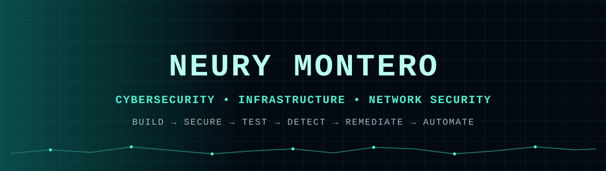
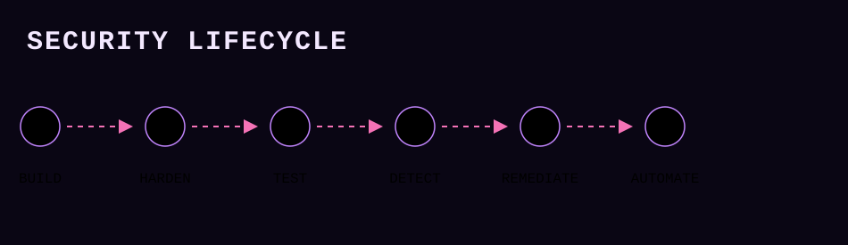
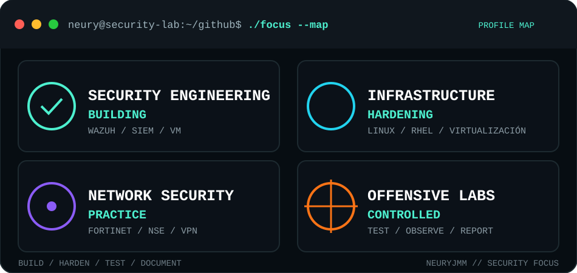

<div align="center">



# Neury Jorge Montero Mejía

**Estudiante de Ciberseguridad · Infraestructura · Seguridad de Redes · Seguridad Defensiva**

<a href="https://www.linkedin.com/in/neuryjmm"></a>
<a href="https://www.youtube.com/@neuryjmm"></a>

</div>

---

## `> whoami`



Estudiante de ciberseguridad en el **ITLA**, construyendo una base práctica en **redes, administración de sistemas, infraestructura y seguridad**.

Mi trabajo se centra en entornos técnicos controlados donde puedo:

- Construir sistemas y redes;
- Endurecer (hardening) infraestructura;
- Probar técnicas de ataque de forma segura;
- Inspeccionar evidencias y eventos de seguridad;
- Resolver fallas;
- Documentar qué funcionó, qué falló y por qué.

Actualmente cuento con las certificaciones **Fortinet FCF, FCA, NSE 1, NSE 2 y NSE 3 Certified in Cybersecurity**. Me estoy formando para desarrollar una carrera en Ingeniería de Seguridad (Security Engineering), con una especialización a largo plazo en Seguridad Defensiva / Blue Team / Seguridad de la Información (InfoSec).

<br clear="right">

---

## `> featured_projects`

<table>
<tr>
<td width="50%" valign="top">

### 🐧 Linux / RHEL — Sistemas Operativos

Comandos y laboratorios documentados durante los módulos de la materia:

- Administración de usuarios y permisos
- Gestión de paquetes y servicios
- Redes en Linux
- Almacenamiento y particiones
- Scripting en Bash
- Hardening básico

**Muestra:** Linux · RHEL · Administración de sistemas · Documentación

[**OPEN REPOSITORY →**](https://github.com/NeuryJMM/Comandos-usados-Modulo1)

</td>
<td width="50%" valign="top">

### 🔐 Cybersecurity labs

Laboratorios sobre ciberseguridad de:

- Dictionary attacks
- Linux security
- Defensive analysis
- Cross Site Scripting
- SQL Inyection
- Malicious PDF

**Shows:** WebApp Security · Ethical Hacking · Tampering · Docker Compose / Dockerfile

[**OPEN REPOSITORY →**](https://github.com/NeuryJMM/TU-REPO-FORTINET)

</td>
</tr>
<tr>
<td width="50%" valign="top">

### 🛡️ Networking labs

Descripción corta de lo que haces en este proyecto:

- Configuración a nivel empresarial con  utilizando VLANs, EtherChannel
(LACP), OSPF, ACLs, NAT/PAT y DHCP/DNS.

**Muestra:** Network Security · Network Management · Network Protocols

[**OPEN REPOSITORY →**](https://github.com/NeuryJMM/TU-REPO-3)

</td>
<td width="50%" valign="top">

### 🌐 Windows Server 2022 Security lab

Descripción corta de lo que haces en este proyecto:

- DNSSEC
- LAPS y Visor de Eventos
- Credential Guard / Block USB
- Bloqueo NTLM
- Encriptación Bitlocker a PC Servidor y Cliente
- Instalación y configuración de Active Directory

**Muestra:** Windows Security · AD · Vulnerability Management · Infrastructure Security

[**OPEN REPOSITORY →**](https://github.com/NeuryJMM/TU-REPO-4)

</td>
</tr>
</table>

---

## `> security_mindset`



Me interesa comprender el ciclo completo, no solo una herramienta:

```text
BUILD -> CONFIGURE -> HARDEN -> TEST
ATTACK -> OBSERVE -> DETECT -> REMEDIATE -> AUTOMATE
```

---

## `> technical_stack`

<div align="center">

### SYSTEMS & INFRASTRUCTURE

**01 // SECURITY**


<sub>Security Engineering · Wazuh · SIEM · Vulnerability Assessment · Network Analysis · System Hardening · Vulnerability Management</sub>

**02 // SYSTEMS & INFRASTRUCTURE**


<sub>Linux · RHEL · Windows Server · Virtualización · VMware · Labs</sub>

**03 // NETWORKING**


<sub>Networking · Routing · Switching · VLANs · ACLs · VPN · IPsec · Fortinet</sub>

**04 // AUTOMATION & CLOUD**


<sub>Bash · Scripting · Python · Automation · Git</sub>

**05 // OFFENSIVE SECURITY**


<sub>Reconnaissance · Enumeration · Web Security · Penetration Testing</sub>

`[ NETWORK SECURITY ] READY // [ OFFENSIVE SECURITY ] BUILDING`

</div>


---

## `> certifications and courses`

### Cybersecurity

- Fortinet Certified Fundamentals (FCF)
- Fortinet Certified Associate (FCA)
- Fortinet NSE 1 Certified in Cybersecurity
- Fortinet NSE 2 Certified in Cybersecurity
- Fortinet NSE 3 Certified in Cybersecurity
- Ciberseguridad de Google
- Ciberseguridad Nivel Avanzado / INDOTEL

### Cloud
- AWS Cloud Practitioner Essentials / Cloud training
- AWS Cloud Fundamentals / Cloud training

### Networking & Systems

- Cisco Networking / CCNA training
- CyberOps Associate / Cisco Networking

> Las certificaciones y cursos aportan contexto a la formación. El portafolio se mantiene enfocado en trabajo práctico, laboratorios y evidencia técnica.

---

## `> current_growth`

```yaml
Security_engineering:
  - Network_security
  - Firewall_management
  - Infrastructure_hardening
  - Vulnerability_management
  - Detection_and_monitoring
  - Automation

Offensive_security:
  - Reconnaissance
  - Enumeration
  - Linux_privilege_escalation
  - Web_security
  - Penetration_testing
```

Estas son **áreas de desarrollo y metas profesionales a nivel académico**, no afirmaciones de dominio a nivel profesional pero me encuentro en formación constante.

---

## `> security_focus`

<div align="center">



<br>

<a href="https://github.com/NeuryJMM"></a>

</div>

---

## `> technical_communication`

Documento mi trabajo técnico, laboratorios y demostraciones.

`Troubleshooting` · `Technical Documentation` · `Lab Design` · `Ethical Assessment` · `Security Analysis`

---

## `> languages`

```text
Spanish   ██████████████████  Native
English   █████████████░░░  Technical / Intermediate
```

---

## `> contact`

<div align="center">

<a href="https://www.linkedin.com/in/neuryjmm"></a>
<a href="https://github.com/NeuryJMM"></a>
<a href="https://www.youtube.com/@neuryjmm"></a>

### Entender el sistema. Asegurar el sistema. Probar el sistema.

`Networking` · `Systems` · `Infrastructure` · `Cybersecurity` · `Network Security`

</div>
